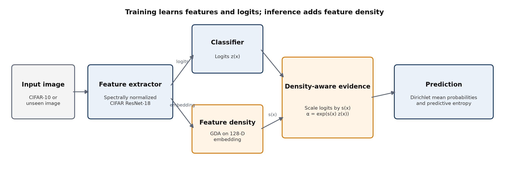
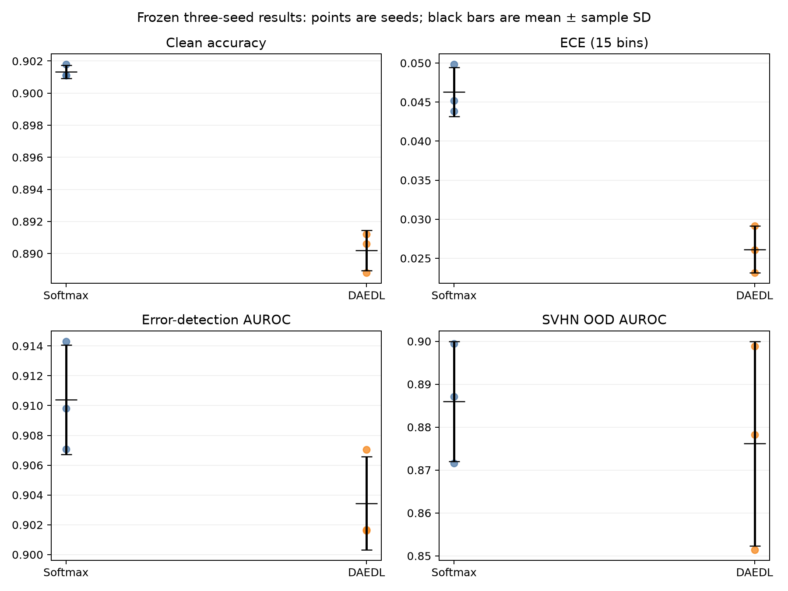
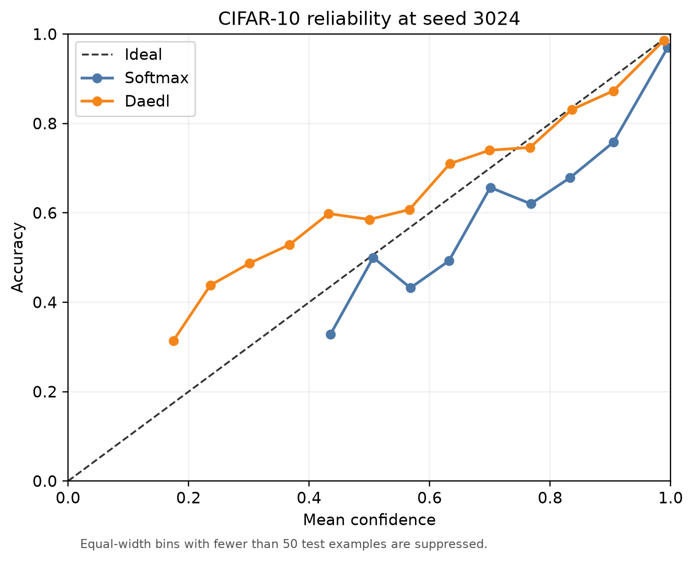
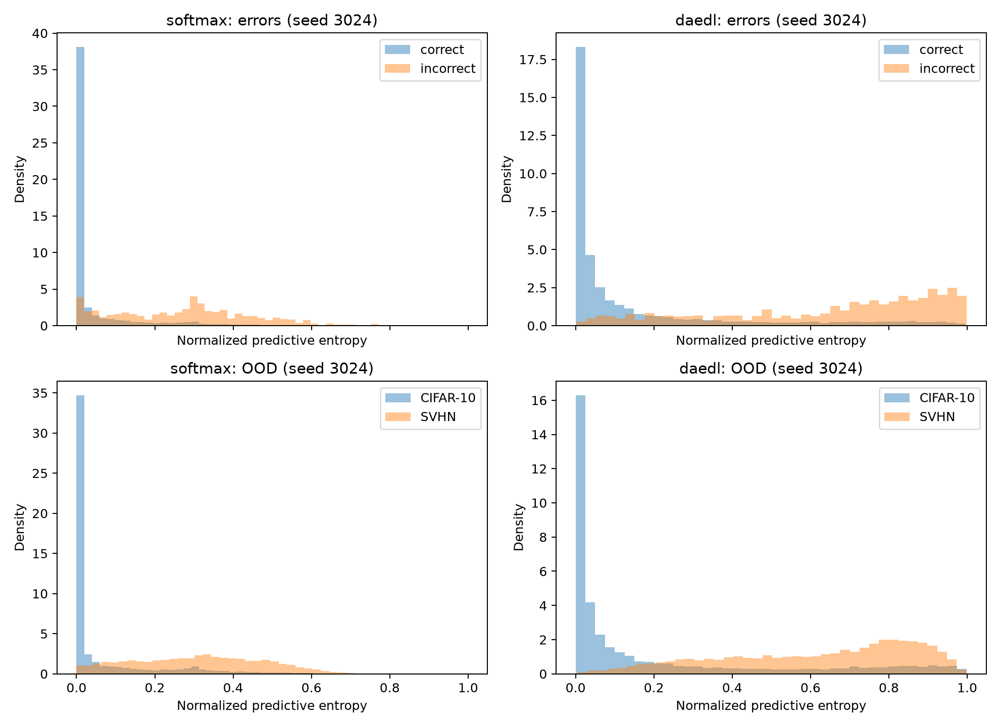

# Density-Aware Evidential Deep Learning for CIFAR-10 Classification and Uncertainty Estimation

**CISC3024 Pattern Recognition**

**AI Assignment #2**

Ziqi Huang

October 2026

## 1 Introduction

Image classifiers produce probability-like scores, but a high maximum score does not by itself show that the model knows when it may be wrong. This assignment used Codex to identify, implement, and evaluate a recent probability-based recognition method. The selected method was Density Aware Evidential Deep Learning (DAEDL), published at ICML 2024 [1]. The research question was: how does DAEDL compare with a conventional Softmax classifier in classification performance, calibration, prediction-error uncertainty, and out-of-distribution uncertainty in an assignment-scale CIFAR-10 experiment?

The three-seed results show different strengths across the evaluation metrics. Softmax achieved higher accuracy (0.9013 ± 0.0004 versus 0.8902 ± 0.0012) and better NLL and Brier score. DAEDL achieved lower ECE in every seed (0.0261 ± 0.0030 versus 0.0463 ± 0.0031). Both methods assigned greater entropy to mistakes, and Softmax had a small error-AUROC advantage. The SVHN OOD ranking changed across seeds, so neither method was consistently better.

## 2 AI-Assisted Algorithm Search and Selection

Codex searched for recent classification and recognition methods grounded in probability or Bayesian theory. Codex first compared DAEDL with conventional evidential deep learning. The candidates were screened by publication date, probabilistic basis, implementation availability, computational cost, and suitability for a CIFAR-10 comparison. DAEDL was selected because it predicts a Dirichlet distribution, models density in learned feature space, and supports classification, calibration, error-detection, and OOD evaluation [1].

The search then checked the official PMLR record, the paper, and the authors' repository. Codex used the repository as a method reference and created a separate implementation adapted to this assignment. The repository audit found CUDA assumptions, incomplete environment information, missing released checkpoints, and reproducibility gaps. Conventional evidential deep learning [2] and calibration work [3] supplied the background needed to interpret the method and metrics.

## 3 Algorithm Description

### 3.1 Softmax classification

For class logits $z_k(x)$, Softmax forms one normalized categorical probability vector for each input:

$$p_{soft}(y=k\mid x)=\frac{e^{z_k(x)}}{\sum_j e^{z_j(x)}}.$$

The largest probability determines the predicted class. Softmax does not directly represent uncertainty over the probability vector itself, which motivates the Dirichlet formulation used by evidential classifiers.

### 3.2 Evidential classification

Evidential classification predicts positive concentrations $\boldsymbol{\alpha}(x)$ for a Dirichlet distribution over class-probability vectors $\boldsymbol{\pi}$. Its predictive categorical probability is the Dirichlet mean, $\mathbb{E}[\pi_k\mid x]=\alpha_k/S$, where $S=\sum_j\alpha_j$. A larger total concentration $S$ places more Dirichlet mass around the mean probability vector; a smaller value represents weaker evidence. This project used normalized predictive entropy as the common uncertainty score so that Softmax and DAEDL were compared on the same quantity.

### 3.3 DAEDL training and density-aware prediction

DAEDL uses $\alpha_k=e^{z_k}$ during training. Normalizing these concentrations gives the same class probabilities as Softmax, while the loss adds the expected squared-error and predictive-variance terms of the Dirichlet plus a KL penalty for misleading evidence. After training, the implementation fits class-conditional full-covariance Gaussian distributions to the 128-dimensional penultimate embeddings. The class mixture defines a feature density, which is min-max normalized against training log densities and clipped to $[0,1]$.

At inference, the density score $s(x)$ scales the logits before concentrations are formed: $\alpha_k(x)=\exp(s(x)z_k(x))$. An embedding far from the fitted training distribution receives a small density score. This moves the concentrations toward one and the expected class probabilities toward a uniform distribution. Spectral normalization is applied to both compared models so that the backbone treatment is matched; for DAEDL it also supports a smoother feature geometry for density estimation.

## 4 AI-Assisted Implementation

### 4.1 Project and environment setup

Codex created an isolated Python 3.11.5 environment with PyTorch 2.14.1 and torchvision 0.29.1 on an Apple M5 MacBook Air with 16 GB unified memory. The project code covers data loading, model construction, Softmax and DAEDL training, density fitting, evaluation, artifact logging, and report figures. Neural-network training used MPS. Selected checkpoints were evaluated on CPU, and DAEDL density estimation used CPU float64 because the MPS backend cannot store float64 tensors [6].

The pilot also found that a reloaded spectral-normalized checkpoint could produce non-finite outputs on the observed MPS evaluation path while the same weights were finite on CPU. The final protocol therefore used the same CPU checkpoint-evaluation policy for both models.

### 4.2 Data pipeline

Each CIFAR-10 example retained its original sample index so that splits and predictions could be audited. The 50,000 official training images were divided into a stratified 45,000-image training set and 5,000-image validation set. Training used random 32-by-32 crops with four-pixel padding, random horizontal flips, tensor conversion, and channel normalization with mean $(0.4914, 0.4822, 0.4465)$ and standard deviation $(0.2023, 0.1994, 0.2010)$. Validation, test, and density fitting used only tensor conversion and the same normalization.

The code saved the train, validation, and test indices for every run. Python, NumPy, PyTorch, and the data-loader generator were seeded. Within a seed, Softmax and DAEDL used identical indices; across seeds, the split and training randomness changed according to the recorded seed.

### 4.3 Model implementation

Both methods used the same CIFAR-adapted ResNet-18. It has a 3-by-3 stride-one stem, base width 32, four residual stages, adaptive average pooling, a 128-dimensional ReLU embedding, and a ten-class linear classifier. The forward method exposes both logits and embeddings because DAEDL needs the embeddings after training.

Spectral normalization was applied to every convolution, learned shortcut projection, the embedding layer, and the classifier for both models. Sharing the feature extractor, data pipeline, and training budget keeps the comparison focused on the prediction and uncertainty mechanisms. Softmax uses cross-entropy. DAEDL uses its evidential objective, followed by feature-density fitting and density-aware inference.

### 4.4 DAEDL density estimation

Density estimation begins after neural-network training. The selected checkpoint is loaded on CPU, and clean embeddings are extracted from all 45,000 training images. The implementation then fits one full-covariance Gaussian per class, using empirical class proportions as mixture weights. The minimum and maximum training log densities define the clipped score $s(x)$ used at inference.

All covariance calculations use CPU float64. Each covariance is symmetrized, and scale-relative diagonal jitter with an absolute floor of $10^{-8}$ is increased until Cholesky factorization succeeds. The run artifacts record global and per-class ranks, constant dimensions, jitter, the training density range, and non-finite fractions. The fitted GDA state and per-example training density values are also saved.

### 4.5 Staged implementation workflow

The implementation was validated in stages. A two-epoch pilot used 5,000 training, 1,000 validation, and 1,000 test images to check finite losses and gradients, checkpoint reloads, GDA fitting, metrics, and artifact output. The first full experiment then trained both models on seed 3024 and evaluated classification, calibration, prediction errors, SVHN OOD detection, and density diagnostics. After those checks passed, the same configuration was then used for seeds 3025 and 3026.

### 4.6 Validation, testing, and reproducibility

The 16 automated tests cover four groups. Probability and loss tests check positive concentrations, normalized probabilities, and finite DAEDL losses and gradients. Metric tests check NLL, Brier score, ECE, entropy, and AUROC/AUPR direction. Density tests cover shapes, CPU float64 state, rank-deficient covariance handling, and finite scores. Reproducibility tests cover stratified disjoint splits, exposed model outputs, and spectral-normalization coverage.

Every final run saved its configuration, environment, split indices, progress log, training history, best-validation and final checkpoints, per-example CIFAR-10 and SVHN predictions, metrics, runtime, and DAEDL density diagnostics where applicable. Aggregate tables were recomputed from the saved predictions. The final six-run audit verified matched within-seed splits, checkpoint selection, probability normalization, finite outputs, positive DAEDL concentrations, score direction, density stability, and sample-SD aggregation.

## 5 Experimental Setup

### 5.1 Datasets and split

CIFAR-10 contains ten natural-object classes with 50,000 official training images and 10,000 official test images [4]. The training portion was divided into a stratified 45,000-image training set and 5,000-image validation set. Validation NLL selected checkpoints, while the official test set remained outside model selection.

SVHN supplied 10,000 deterministically selected test images for OOD evaluation [5]. CIFAR-10 contains natural objects; SVHN contains street-view house-number digits. Their visual domains and semantic classes differ, making SVHN a useful OOD dataset for this controlled comparison without implying that it is the only possible benchmark.

### 5.2 Fair comparison design

Softmax and DAEDL shared the same backbone, spectral-normalization configuration, split, training augmentation, batch size, optimizer, epoch budget, learning-rate schedule, and checkpoint criterion within each seed. These controls reduce differences caused by the feature extractor or training resources. DAEDL necessarily differs in its evidential objective, post-training density model, and density-aware inference.

### 5.3 Training protocol

Each run trained for 30 epochs with batch size 64, AdamW, an initial learning rate of $10^{-3}$, weight decay $5\times10^{-4}$, and cosine decay to $10^{-5}$. Both models selected the checkpoint with minimum validation NLL. This provides a common probability-based criterion even though their training objectives differ. The best-validation checkpoint and the final-epoch checkpoint were both saved, and the test set was never used for selection.

| Setting | Value |
|---|---|
| Models | Softmax and DAEDL |
| Backbone | Spectrally normalized CIFAR ResNet-18, base width 32 |
| Embedding | 128 dimensions |
| Split | 45,000 train / 5,000 validation / 10,000 test |
| Seeds | 3024, 3025, 3026 |
| Optimizer | AdamW, LR $10^{-3}$, weight decay $5\times10^{-4}$ |
| Schedule | Cosine decay to $10^{-5}$ over 30 epochs |
| Batch size | 64 |
| Selection | Minimum validation NLL |
| Hardware | Apple M5 MacBook Air, 16 GB unified memory |
| Devices | MPS training; CPU evaluation and float64 GDA |
| OOD protocol | CIFAR-10 ID, SVHN OOD, normalized entropy, OOD positive |

### 5.4 Three-seed replication

Seeds 3024, 3025, and 3026 each defined a complete model run. The seed controlled the stratified train-validation split, Python and NumPy random states, PyTorch initialization and training randomness, and the data-loader generator. Softmax and DAEDL shared indices within each seed. Results are reported as mean ± sample SD across the three runs, not across individual images. Three seeds were used to check whether the comparison remained consistent under different data splits and training randomness.

### 5.5 Classification evaluation

Accuracy is the fraction of correct CIFAR-10 predictions. Macro F1 averages class-level F1 scores with equal weight for each class. CIFAR-10 is balanced, but Macro F1 still checks whether performance is distributed across classes instead of relying only on total accuracy.

### 5.6 Calibration evaluation

Negative log-likelihood uses the probability assigned to the true class and gives a large penalty to confident mistakes. ECE divides predictions into 15 equal-width confidence bins and computes the count-weighted difference between mean confidence and observed accuracy in each bin. The multiclass Brier score is the mean squared difference between the predicted probability vector and the one-hot target. Using all three metrics gives a broader view of probability quality than relying on a single calibration measure.

### 5.7 Prediction-error uncertainty

This experiment asks whether uncertainty can identify predictions that are likely to be wrong. Correct and incorrect CIFAR-10 predictions are separated using the ground-truth labels. Normalized predictive entropy lies in $[0,1]$; larger values indicate a more diffuse class distribution. Prediction error is the positive class. AUROC measures ranking across thresholds, and AUPR summarizes precision-recall performance for the error class.

### 5.8 OOD evaluation

The OOD experiment asks whether the models assign greater uncertainty to inputs outside the CIFAR-10 distribution. CIFAR-10 is labelled ID, SVHN is labelled OOD, and OOD is the positive class. Normalized predictive entropy is the common score for both models, which avoids comparing method-specific scales. DAEDL's secondary score, $1-s(x)$, is evaluated separately as density-derived uncertainty.

### 5.9 Numerical stability and device policy

Training used MPS, while loaded-checkpoint evaluation and feature extraction used CPU for both models. DAEDL covariance and density calculations used CPU float64, adaptive diagonal jitter, and Cholesky checks. Evaluation also checked finite outputs, probability sums, positive concentrations, density bounds, and score orientation before aggregation.

### 5.10 Experiment questions

| Experiment | Main question | Metrics |
|---|---|---|
| Classification | How accurately does the model classify CIFAR-10? | Accuracy, Macro F1 |
| Calibration | Do predicted probabilities match empirical correctness? | NLL, ECE, Brier |
| Error uncertainty | Can uncertainty identify incorrect predictions? | Entropy, AUROC, AUPR |
| OOD uncertainty | Can uncertainty distinguish CIFAR-10 from SVHN? | Entropy, AUROC, AUPR |

## 6 Results

### 6.1 Classification and calibration

| Metric | Softmax | DAEDL |
|---|---:|---:|
| Accuracy | 0.9013 ± 0.0004 | 0.8902 ± 0.0012 |
| Macro F1 | 0.9012 ± 0.0004 | 0.8899 ± 0.0011 |
| NLL | 0.3367 ± 0.0059 | 0.4328 ± 0.0017 |
| ECE-15 | 0.0463 ± 0.0031 | 0.0261 ± 0.0030 |
| Brier score | 0.1504 ± 0.0014 | 0.1718 ± 0.0005 |

Softmax was about one percentage point more accurate in every seed. DAEDL's lower ECE also repeated in every seed, but NLL and Brier score favored Softmax. The calibration metrics therefore do not support one universal ranking. ECE measures binned agreement between confidence and observed accuracy, whereas NLL and Brier score evaluate the complete predictive distribution as proper scoring rules.

The plot shows seed 3024 as an example. Bins with fewer than 50 test examples are suppressed for readability, while ECE is calculated from all 15 equal-width bins.

### 6.2 Error and OOD uncertainty

| Metric | Softmax | DAEDL |
|---|---:|---:|
| Error AUROC | 0.9104 ± 0.0037 | 0.9034 ± 0.0031 |
| Error AUPR | 0.4926 ± 0.0202 | 0.4958 ± 0.0081 |
| SVHN OOD AUROC | 0.8860 ± 0.0140 | 0.8762 ± 0.0238 |
| SVHN OOD AUPR | 0.8296 ± 0.0234 | 0.7964 ± 0.0377 |

Both models assigned much greater normalized entropy to incorrect predictions than to correct ones. Softmax had a small but consistent error-AUROC advantage. DAEDL produced larger entropy values, while AUROC showed how well each score ranked incorrect predictions above correct ones.

DAEDL consistently assigned greater entropy to SVHN than to CIFAR-10. Softmax had higher OOD AUROC at seeds 3024 and 3026; DAEDL was higher at seed 3025. Neither method was consistently better across the three seeds.

## 7 Discussion

Softmax achieved higher clean classification accuracy in all three seeds. In this setup, DAEDL's uncertainty modelling did not improve classification performance. DAEDL consistently achieved lower ECE, whereas Softmax achieved lower NLL and Brier scores. These metrics can disagree because ECE measures binned confidence-frequency agreement, while NLL and Brier score evaluate the full probability distribution.

DAEDL produced higher entropy for correct, incorrect, ID, and OOD samples. That wider numerical range made mistakes and SVHN inputs visibly uncertain. AUROC, however, depends on how consistently the score ranks errors or distribution shifts, and DAEDL did not improve that ranking consistently.

Multiple seeds changed the interpretation of OOD performance. Seed 3024 favored Softmax, seed 3025 favored DAEDL, and seed 3026 favored Softmax. The three-seed mean favored Softmax, but the ordering was not consistent. With only three runs, the comparison is reported descriptively without a hypothesis test.

The density diagnostics show another trade-off. DAEDL embeddings remained rank deficient: global centered rank was 93, 99, and 101 out of 128, with 35, 29, and 27 constant dimensions. Per-class covariance ranks ranged from 76 to 95. Adaptive jitter remained around $10^{-8}$ to $10^{-7}$, and every density computation was finite. Density fitting remained numerically stable, although the reduced embedding rank is a limitation of this implementation.

This is an assignment-scale evaluation of DAEDL's central ideas. The paper used a different architecture and larger training setup. Here, the compact ResNet-18, 128-dimensional embedding, 30 epochs, and laptop hardware made matched multi-seed experiments feasible. The results apply to this local setup and are not an exact reproduction of the paper's broader benchmarks.

## 8 Limitations

The evaluation uses one in-distribution dataset, one OOD dataset, and three seeds. Corruption experiments were outside the final scope of this assignment. No exhaustive hyperparameter search was performed, and the study did not cover other architectures or alternative evidential methods. MPS and CPU adaptations introduce an engineering difference from the authors' CUDA-oriented environment. DAEDL's embedding space was rank deficient even though covariance stabilization remained finite. The findings apply to this controlled CIFAR-10/SVHN setup.

## 9 What I Learned

Before this assignment, I tended to read a classifier's probability as a direct statement of confidence. The experiment showed me that uncertainty needs separate evidence. A model can be accurate and still assign probabilities that do not match how often it is correct. It can also produce high entropy on difficult images without ranking every mistake or OOD sample better than another model.

I learned that calibration is not a single number. DAEDL had lower ECE in every seed, which initially looks like a clear calibration advantage. NLL and Brier score gave the opposite ranking. This result helped me understand that ECE depends on confidence bins, while proper scoring rules evaluate the full probability distribution and penalize confident errors differently. I should therefore explain which calibration property a metric measures instead of using “better calibrated” without qualification.

I also expected a method designed for uncertainty to outperform Softmax clearly on OOD detection. The result at seed 3024 initially pointed in the other direction. After running the other two seeds, my interpretation changed: DAEDL was better at seed 3025, while Softmax was better again at seed 3026. The full result was mixed across seeds.

The project also taught me to separate uncertainty magnitude from ranking quality. DAEDL produced much greater entropy on incorrect and SVHN inputs. Softmax still had slightly better error AUROC and a higher mean OOD AUROC. The separation between groups matters more than the absolute scale when models use different uncertainty parameterizations.

Codex wrote the code and ran the experiments. I found it especially useful for debugging and checking the experiment, not only for generating code. The workflow still needed tests for formulas and metrics, matched baselines, fixed checkpoint rules, checks for OOD score direction, probability normalization, and independent recomputation from saved predictions. It also helped me inspect failures, record changes, and keep mixed results in the final analysis.

Finally, I learned how theoretical ideas meet hardware and numerical constraints. MPS was suitable for neural-network training but could not run the float64 covariance calculations. Reloaded spectral-normalized checkpoints also required CPU evaluation in this environment. The embedding covariances were rank deficient, so the implementation needed adaptive diagonal loading and diagnostics. These hardware and numerical checks became part of the experimental workflow.

## 10 Conclusion

Codex implemented DAEDL and compared it with a matched Softmax baseline across three CIFAR-10 seeds. DAEDL consistently reduced ECE. Softmax achieved better accuracy, Macro F1, NLL, Brier score, and error-detection AUROC. Both methods assigned greater uncertainty to mistakes, and DAEDL assigned greater entropy to SVHN than CIFAR-10. The OOD ranking changed across seeds, and the added probabilistic structure did not improve every predictive or uncertainty measure.

## 11 Source Code

The complete source code, experiment scripts, configurations, and reproducibility files for this assignment are available at:

**https://github.com/huangziqi-1/CISC3024-Assignment2-DAEDL**

## 12 References

[1] Yoon, T., and Kim, H. (2024). “Uncertainty Estimation by Density Aware Evidential Deep Learning.” *Proceedings of the 41st International Conference on Machine Learning*, PMLR 235, 57217–57243. https://proceedings.mlr.press/v235/yoon24a.html

[2] Sensoy, M., Kaplan, L., and Kandemir, M. (2018). “Evidential Deep Learning to Quantify Classification Uncertainty.” *Advances in Neural Information Processing Systems 31*. https://papers.nips.cc/paper/2018/hash/a981f2b708044d6fb4a71a1463242520-Abstract.html

[3] Guo, C., Pleiss, G., Sun, Y., and Weinberger, K. Q. (2017). “On Calibration of Modern Neural Networks.” *Proceedings of the 34th International Conference on Machine Learning*, PMLR 70, 1321–1330. https://proceedings.mlr.press/v70/guo17a.html

[4] Krizhevsky, A. (2009). *Learning Multiple Layers of Features from Tiny Images*. Technical report, University of Toronto. https://www.cs.toronto.edu/~kriz/learning-features-2009-TR.pdf

[5] Netzer, Y., Wang, T., Coates, A., Bissacco, A., Wu, B., and Ng, A. Y. (2011). “Reading Digits in Natural Images with Unsupervised Feature Learning.” *NIPS Workshop on Deep Learning and Unsupervised Feature Learning*. https://cs.stanford.edu/~twangcat/papers/nips2011_housenumbers.pdf

[6] PyTorch Contributors. “MPS backend.” *PyTorch documentation*. https://docs.pytorch.org/docs/main/notes/mps.html

[7] Yoon, T., and Kim, H. “DAEDL official implementation.” GitHub. https://github.com/TaeseongYoon/DAEDL
